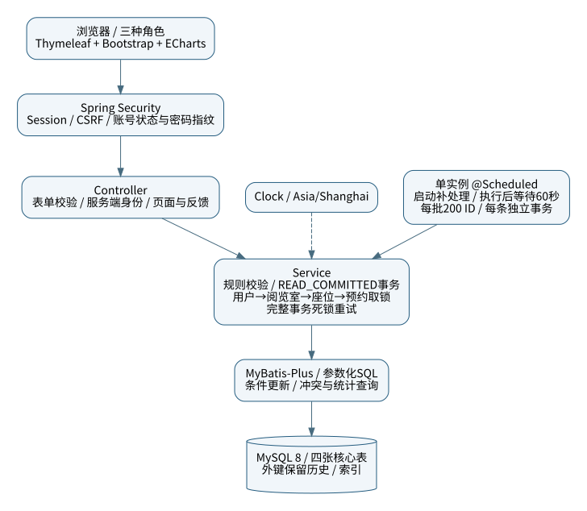
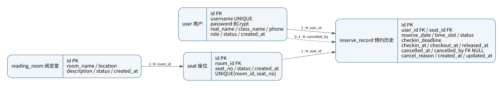
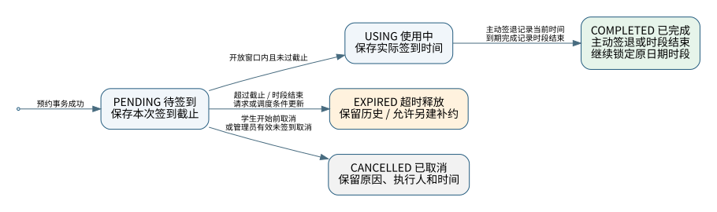

# 系统设计与图表

题目：基于 Spring Boot 的高校图书馆座位预约与签到管理系统的设计与实现。

本文件描述实际代码。SVG可插入Word或答辩幻灯片；同目录的`.dot`为可编辑源，安装Graphviz后可用`dot -Tsvg docs/diagrams/er.dot -o docs/diagrams/er.svg`重新生成。

## 单体结构

浏览器通过表单访问Controller，Spring Security在前面处理登录、角色和CSRF。Controller只接收允许修改的表单字段，从Authentication读取身份；Service负责时间、状态与事务；Mapper使用参数化SQL查询或条件更新。Thymeleaf渲染页面，Bootstrap和ECharts从jar内部加载，不依赖CDN。

业务Clock固定为Asia/Shanghai。单实例调度在应用就绪时补处理，随后每次执行后等待60秒；每批最多200个ID，每条独立取锁和提交，单条失败留待下轮重试。

## 四表ER图

- 一个用户可有多条预约历史，一个阅览室包含多个座位，一个座位可对应不同日期、时段及多次释放后的预约历史。
- `cancelled_by`可空，关联执行取消的用户；`user_id`表示预约学生，两者含义不同。
- 外键不级联删除历史。有预约历史的座位使用停用代替删除，用户不提供删除操作。
- 不对全部历史的`seat_id + reserve_date + time_slot`设置唯一约束，否则释放后不能补约。

## 预约状态

PENDING未过期、USING、COMPLETED锁定学生及座位的原日期时段。EXPIRED与CANCELLED保留历史但允许另建预约。补约是插入新记录，不把旧EXPIRED改回PENDING。

普通签到从开始前15分钟至开始后15分钟，截止时刻有效。超过普通截止才创建的新预约获得10分钟签到时间。提前签退保存实际时间，仍保留该时段占用；忘记签退由任务按时段结束时刻补记，不能使用任务延迟执行的时间。

## 事务与竞态

写入顺序为用户→阅览室→座位→预约。管理员涉及两名用户时按ID升序锁操作者和目标，再锁资源；空间维护入口也在锁定操作者后重新检查数据库权限。预约成功与资源停用不能同时绕过对方的校验。

所有预约状态写入使用独立READ_COMMITTED事务，在等待行锁后重新检查冲突和当前时间。SQL还包含原状态和截止条件。实际测试发现InnoDB外键检查可带来额外隐式锁，因此仅对MySQL死锁1213在完整回滚后最多尝试3次；其他错误继续失败。

账号管理在单JVM内串行到提交，且不能禁用自己、修改自身角色或移除最后一个启用超管。禁用和角色变化前必须处理PENDING/USING，不能遗留无法签到或签退的记录。

## 会话与密码

BCrypt保存密码，表单不回显明文或散列。修改个人密码需验证当前密码；重置密码、角色和状态变化在提交后使旧Session失效。认证主体保留BCrypt散列的SHA-256指纹，原凭据仍由Spring擦除；每次已认证请求比对指纹、角色和启用状态，用于拒绝并发登录时漏过会话登记的旧凭据。

所有写入保留CSRF。脚本只允许应用同源资源，统计数据置于不可执行JSON节点，由外部脚本读取；名称和取消原因转义。错误页面不展示SQL、异常堆栈或表单密码。

## 使用边界

只支持一个应用实例；Session与账号管理串行保护在JVM内。网页签到记录线上按钮操作，不能验证学生真实到馆。预约率使用当前启用座位作分母，历史已用座位被停用时可超过100%；页面如实显示并解释，零分母显示“—”。
