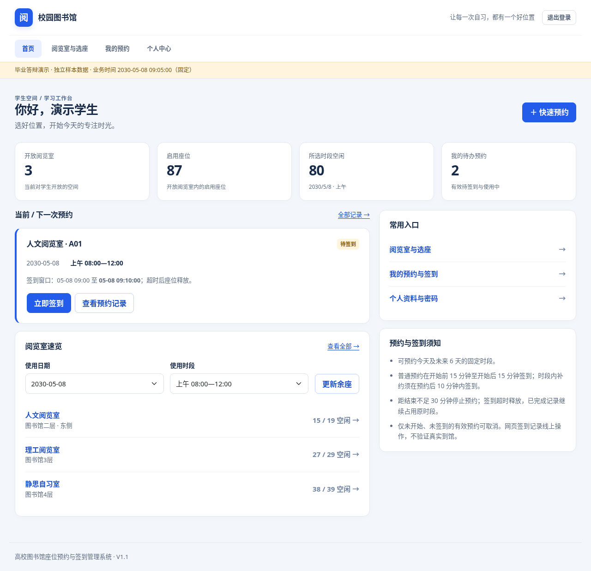
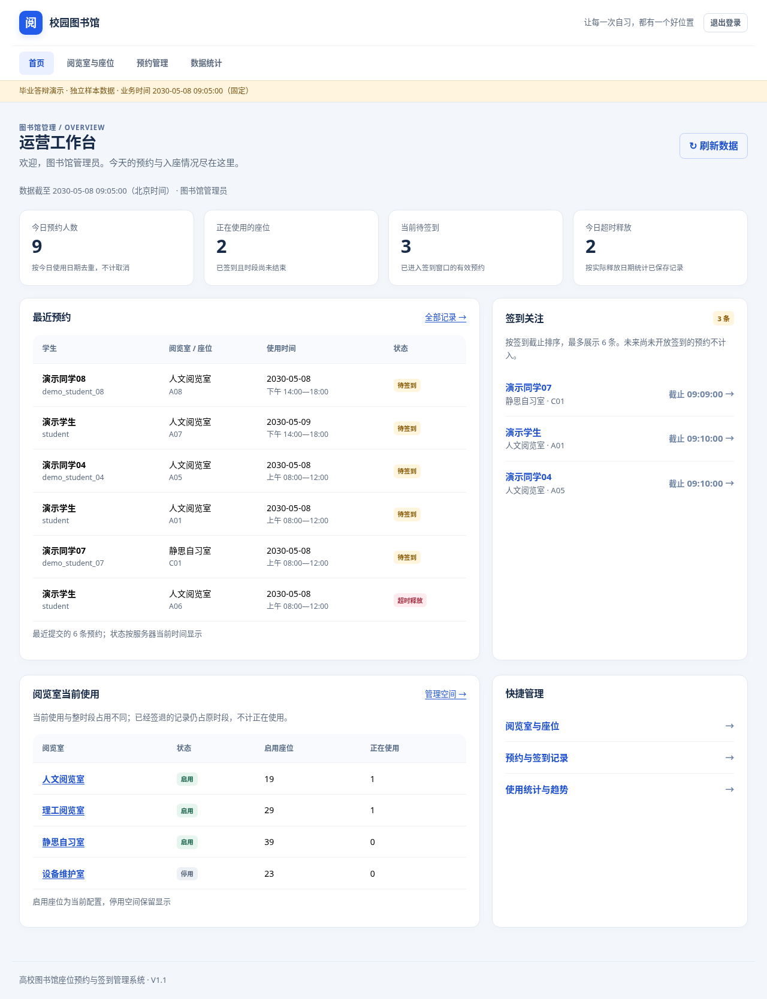

# V1.1 实际页面截图

以下54张截图由Chromium操作真实打包应用生成，使用独立演示库和2030-05-08业务时钟。页面明确标识演示样本；没有将样本写入正常库。截图不是设计稿，完整自动化及业务结果另见[V1.1记录](../ui-v1.1.md)。

| 页面 | 桌面 | 手机390px |
|---|---|---|
| 登录 | [查看](01-login.png) | [查看](01-login-mobile.png) |
| 学生注册 | [查看](02-register.png) | [查看](02-register-mobile.png) |
| 学生首页 | [查看](03-student-home.png) | [查看](03-student-home-mobile.png) |
| 个人中心 | [查看](04-profile.png) | [查看](04-profile-mobile.png) |
| 阅览室列表 | [查看](05-rooms.png) | [查看](05-rooms-mobile.png) |
| 选座与确认 | [查看](06-seats.png) | [查看](06-seats-mobile.png) |
| 我的预约（使用中） | [查看](07-my-reservations.png) | [查看](07-my-reservations-mobile.png) |
| 管理工作台 | [查看](08-admin-home.png) | [查看](08-admin-home-mobile.png) |
| 阅览室管理 | [查看](09-admin-rooms.png) | [查看](09-admin-rooms-mobile.png) |
| 座位管理 | [查看](10-admin-seats.png) | [查看](10-admin-seats-mobile.png) |
| 预约管理 | [查看](11-admin-reservations.png) | [查看](11-admin-reservations-mobile.png) |
| 统计 | [查看](12-statistics.png) | [查看](12-statistics-mobile.png) |
| 用户管理 | [查看](13-users.png) | [查看](13-users-mobile.png) |

另外覆盖用户维护、待签到、本人座位、记录详情、筛选无结果、无预约、无统计、用户第二页、表单错误、登录错误和400/403。所有文件SHA-256及实际运行平台、时钟、jar校验值见[manifest.json](manifest.json)。

- [预约待签到](24-my-reservations-pending.png)、[时间详情](25-reservation-detail.png)
- [空预约](31-empty-reservations.png)、[无搜索结果](32-empty-search.png)、[无统计](30-empty-statistics.png)
- [重复座位校验](36-seat-validation-error.png)、[400](34-bad-request.png)、[403](17-forbidden.png)
- [用户第二页](33-users-page2.png)、[用户维护](18-user-maintenance.png)
- [签到后后台指标变化](39-admin-after-checkin.png)、[签退后记录](40-my-reservations-completed.png)

[原版18张截图](../ui-v1.1/before/)及[改版任务与对照](../ui-v1.1.md)保留，可按同名主要页面比较。截图中指标在实际签到、签退过程中会变化，这是不同操作阶段的真实结果。
