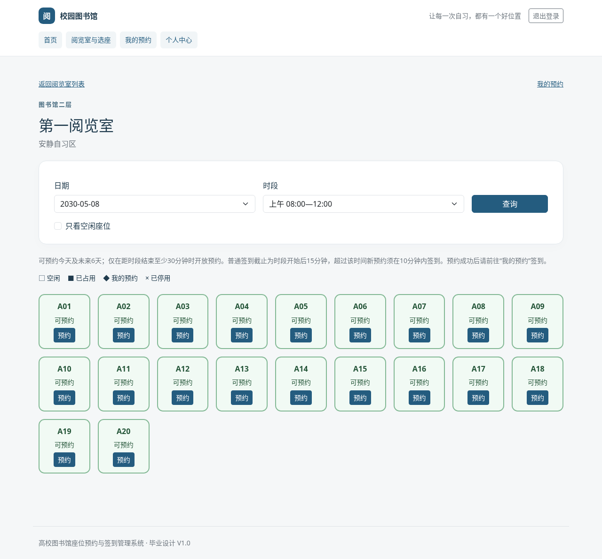
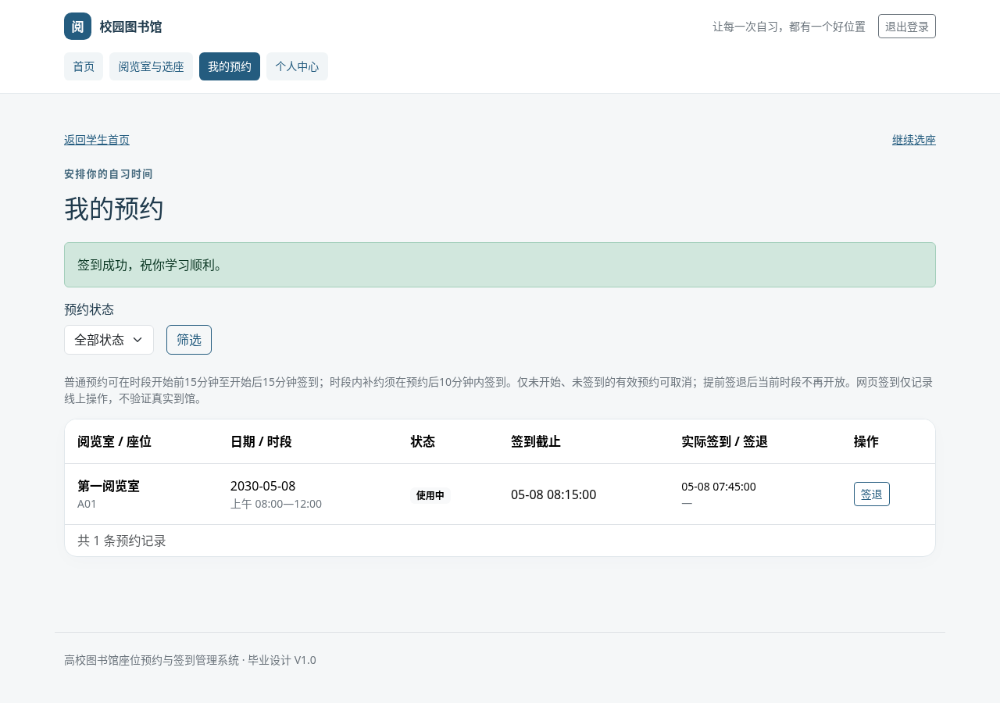
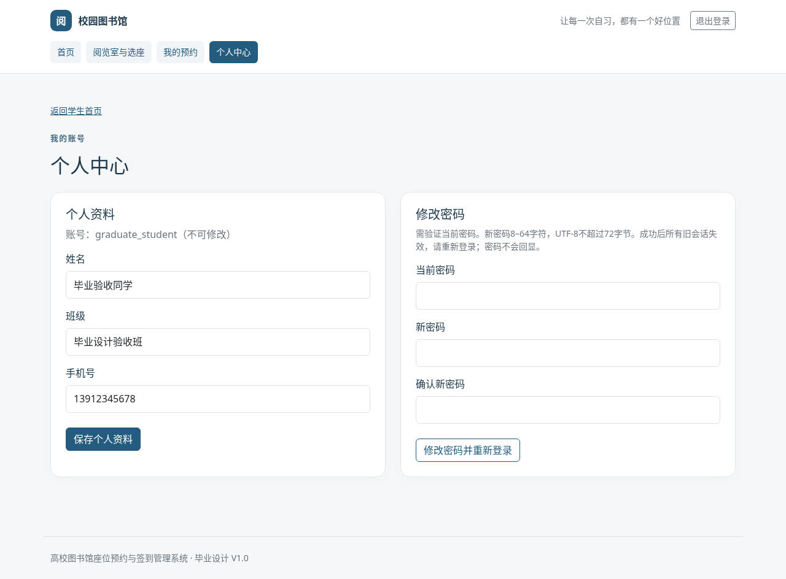

# 实际页面截图

截图由Chromium操作真实Spring应用生成，使用隔离测试库和2030-05-08的外部测试Clock；不是设计稿或真实运营数据。当前正常应用使用服务器实际时间。截图中手机号和账号为验收夹具，不含密码。

| 页面 | 截图 |
|---|---|
| 登录 | [打开截图](01-login.png) |
| 学生注册 | [打开截图](02-register.png) |
| 学生首页 | [打开截图](03-student-home.png) |
| 个人中心 | [打开截图](04-profile.png) |
| 阅览室列表 | [打开截图](05-rooms.png) |
| 座位预约 | [打开截图](06-seats.png) |
| 我的预约（使用中） | [打开截图](07-my-reservations.png) |
| 管理首页 | [打开截图](08-admin-home.png) |
| 阅览室管理 | [打开截图](09-admin-rooms.png) |
| 座位管理 | [打开截图](10-admin-seats.png) |
| 预约管理及审计 | [打开截图](11-admin-reservations.png) |
| 统计 | [打开截图](12-statistics.png) |
| 用户管理 | [打开截图](13-users.png) |
| 手机个人中心 | [打开截图](14-profile-mobile.png) |
| 手机选座 | [打开截图](15-seats-mobile.png) |
| 手机统计 | [打开截图](16-statistics-mobile.png) |
| 403权限提示 | [打开截图](17-forbidden.png) |
| 用户维护 | [打开截图](18-user-maintenance.png) |

## 学生选座

## 我的预约

## 个人中心

其余页面可使用上表打开原图。图片尺寸和SHA-256见[manifest.json](manifest.json)。
